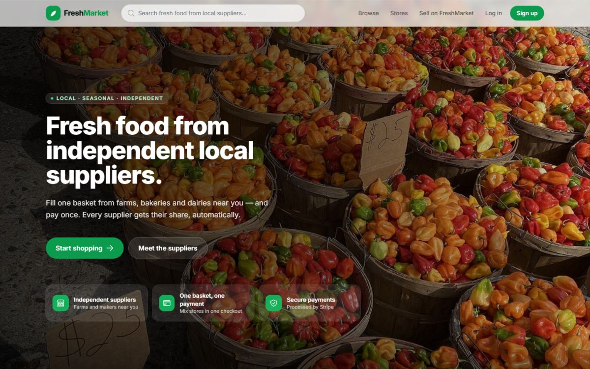
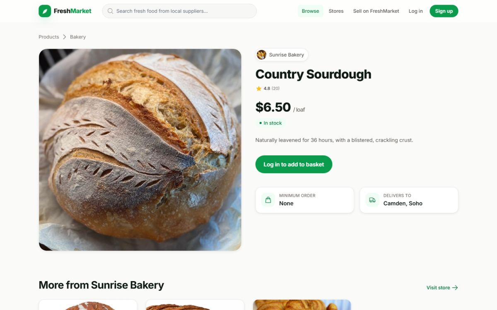
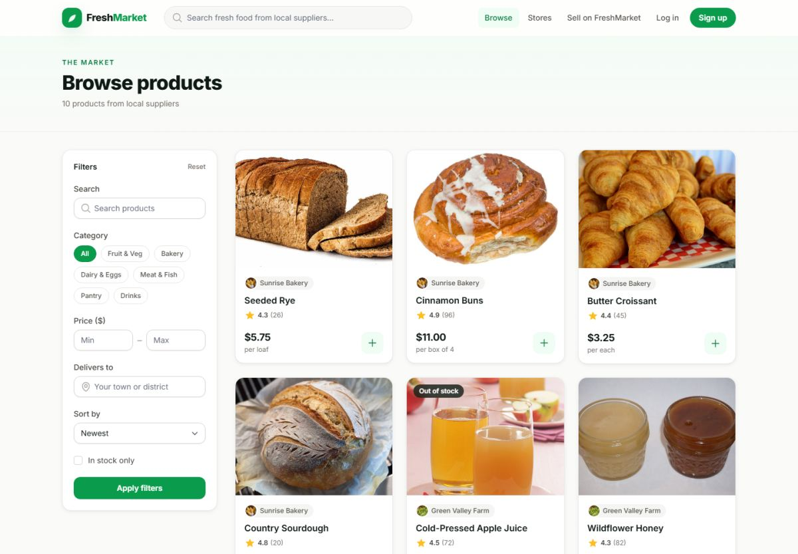
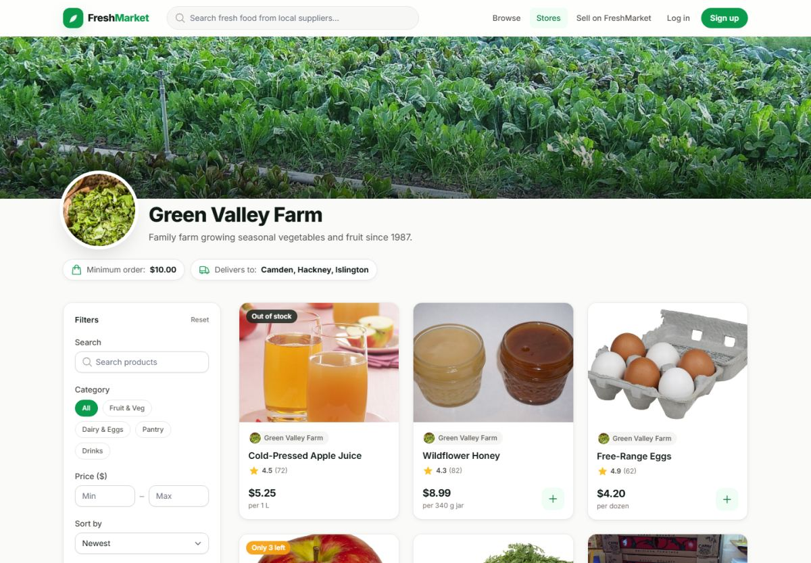
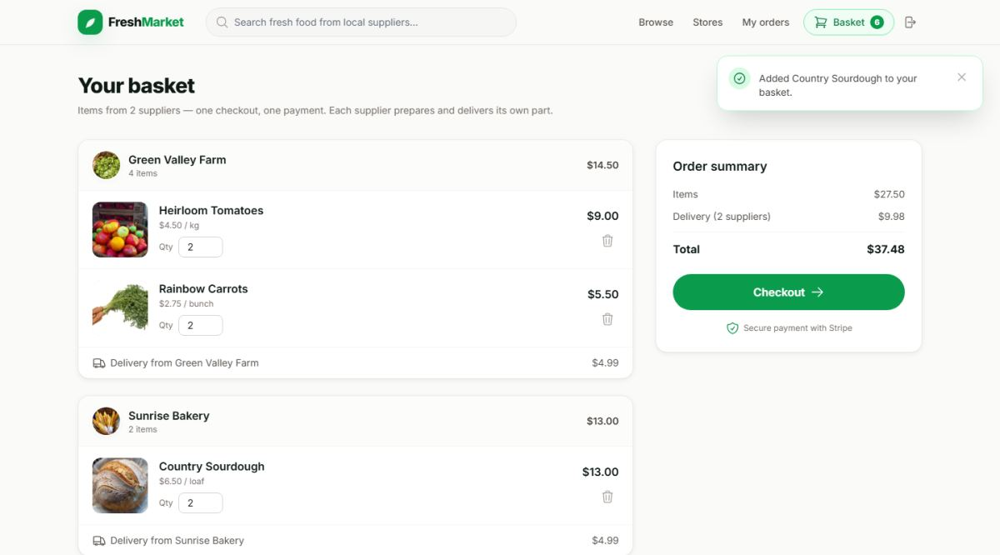
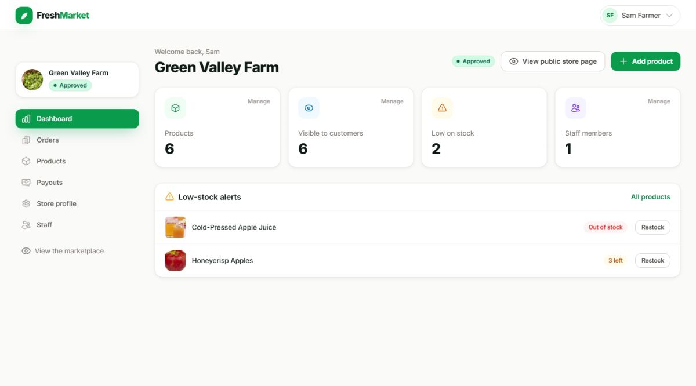
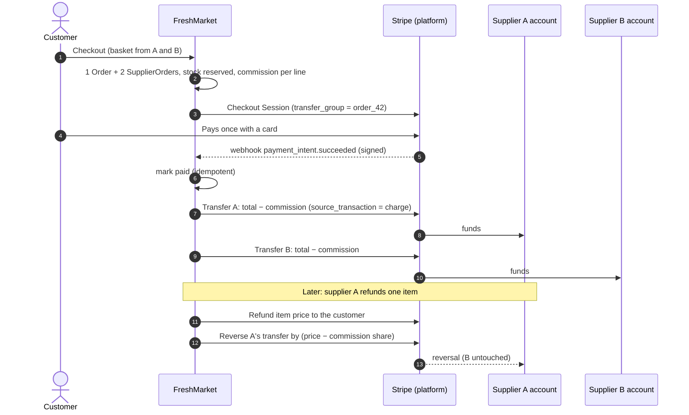
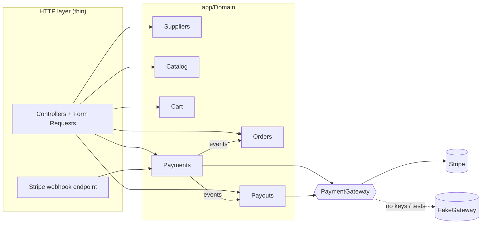

# FreshMarket

**A multi-vendor food marketplace built with Laravel and Stripe Connect.**
Independent suppliers run their own stores, products and orders. Customers fill one basket
from many suppliers and pay once. The platform splits each payment between the suppliers
and handles partial refunds that only touch the supplier involved.

Built as a portfolio project to show production-style payment handling: integer money, idempotent
webhooks, Stripe Connect *separate charges and transfers*, and partial refunds with transfer
reversals. Verified end to end against Stripe test mode.

---

## Highlights

- **One basket, many suppliers.** Checkout creates one parent order and one sub-order per
  supplier, each with its own subtotal, delivery fee, commission and fulfilment status.
- **Stripe Connect, separate charges and transfers.** One Stripe Checkout payment on the platform,
  then one transfer per supplier (`total − commission`) to their connected account.
- **Webhooks are the source of truth.** Orders are marked paid only by the signature-verified
  `payment_intent.succeeded` webhook, never by the browser redirect. Every event is stored and
  processed exactly once.
- **Partial refunds.** Refund a single item (or cancel one supplier's part). The customer is
  refunded, the platform returns its commission share, and **only that supplier's transfer is
  reversed**. Other suppliers are untouched.
- **Strict multi-tenancy.** Suppliers only ever see their own products and sub-orders: roles,
  ownership policies, scoped route bindings, and tests that attack it.
- **Money is never a float.** Integer cents everywhere and commission in basis points, rounded
  once per line, so refunds reverse exactly what was charged.
- **Runs without Stripe.** With no keys configured, a `FakeGateway` stands in. The whole app works
  offline and the test suite never touches the network.
- **Polished, responsive UI.** A Tailwind design system (Inter, a green brand palette, soft shadows),
  real food photography, scroll-reveal and hover animations, a fly-to-basket effect, toast
  notifications, skeleton loaders, animated status pills and count-up stats. It's all lightweight
  (Alpine.js) and switched off under `prefers-reduced-motion`.

## Screenshots

| Home | Product |
|---|---|
|  |  |
| **Catalogue with filters** | **Supplier store** |
|  |  |
| **Basket grouped by supplier** | **Supplier dashboard** |
|  |  |

Photos are free-licence images from Wikimedia Commons; see [docs/IMAGE_CREDITS.md](docs/IMAGE_CREDITS.md).

## Stack

Laravel 13 · PHP 8.3 · MySQL (SQLite for local/tests) · Blade + Tailwind + Alpine.js (Breeze) ·
spatie/laravel-permission · Stripe PHP SDK (Connect, Accounts v2) · Pest (194 tests)

---

## How the money moves



Worked example (the client-demo order):

| | Supplier A (10%) | Supplier B (12%) | Order |
|---|---|---|---|
| Customer pays (items + delivery) | $19.49 | $11.49 | **$30.98** |
| Commission (goods only) | $1.45 | $0.78 | $2.23 |
| Transferred | $18.04 | $10.71 | |
| Refund 1 item ($2.75) | customer +$2.75 · A reversed −$2.47 · platform returns $0.28 | untouched | |

## Architecture



```
app/Domain/
├── Shared/     Money value object (int cents), Role & Permission enums, ModuleServiceProvider
├── Suppliers/  stores, approval, staff invitations, delivery areas
├── Catalog/    products, categories, images, atomic stock (no overselling)
├── Cart/       one basket per customer, grouped by supplier
├── Orders/     Order → SupplierOrder → OrderItem, status state machine, PlaceOrder
├── Payments/   PaymentGateway (Stripe | Fake), checkout, IssueRefund, webhook registry
└── Payouts/    per-supplier transfers, reversals, Connect onboarding, earnings
```

Each module registers its own policies, event listeners and webhook handlers in its own service
provider, so adding a feature never means editing another module. Controllers only validate,
authorize and call an Action.

<details>
<summary><strong>Key design decisions</strong></summary>

- **Idempotency everywhere money moves.** Transfers, refunds and reversals send idempotency keys
  derived from Stripe IDs (charge, PaymentIntent, transfer), so retries can never pay twice, even
  after the local database is reset.
- **Refunds reserve, then call Stripe.** Refunded quantities are reserved in a locked transaction
  before the Stripe call, so double clicks can't double-refund. If Stripe declines, the totals are
  restored.
- **Reversals are computed, not trusted.** The reversal amount is "what the supplier holds − what
  they should hold now", which stays correct whether the transfer was sent before or after the refund.
- **Failures are isolated per supplier.** If one supplier's transfer fails, the others still go
  through. Blocked transfers are released automatically when Stripe reports the account as ready.
- **Snapshots.** Product names, prices and commission rates are copied onto orders, so later edits
  never change history.
- **Accounts v2.** Connected accounts use Stripe's Accounts v2 API (recipient configuration with the
  `stripe_transfers` capability). Webhooks accept both classic and v2 "thin" events.
</details>

---

## Getting started

```bash
git clone https://github.com/Hassaan-ahmad-911/freshmarket.git
cd freshmarket
composer install
npm install && npm run build
cp .env.example .env            # MySQL by default; or set DB_CONNECTION=sqlite
php artisan key:generate
php artisan migrate --seed
php artisan storage:link
composer run dev                # http://localhost:8080 + queue worker + logs
```

Without Stripe keys everything still works: a local test payment page replaces Stripe Checkout.

### With Stripe (test mode)

1. Enable **Connect** in your Stripe Dashboard (test mode).
2. Add your test keys to `.env`: `STRIPE_KEY=pk_test_…` and `STRIPE_SECRET=sk_test_…`.
3. In one terminal, forward webhooks (uses your key from `.env`, no `stripe login` needed):
   ```bash
   php artisan stripe:listen
   ```
   Copy the printed `whsec_…` into `STRIPE_WEBHOOK_SECRET`, then run `php artisan config:clear`.
4. `php artisan migrate:fresh --seed` creates a verified test connected account for each demo supplier.
5. `composer run dev`, then pay with card `4242 4242 4242 4242`, any future date and any CVC.

Useful commands:

| Command | What it does |
|---|---|
| `php artisan stripe:listen` | Forward Stripe events to the app (`--accounts` for Accounts v2 onboarding events) |
| `php artisan stripe:demo-accounts [--fresh]` | (Re)create demo suppliers' connected test accounts |
| `php artisan payouts:retry` | Retry blocked or failed transfers and reversals |
| `php artisan orders:stripe-links FM-000001` | Print the Stripe Dashboard links for an order |
| `php artisan orders:release-unpaid` | Release stock of abandoned checkouts (scheduled) |

A step-by-step client demo (with the Stripe Dashboard pages to show) is in
[docs/demo-script.md](docs/demo-script.md).

### Demo accounts

Password for all: `password`

| Role | Email | Notes |
|---|---|---|
| Customer | customer@freshmarket.test | |
| Supplier owner | owner@freshmarket.test | Green Valley Farm, 10% commission |
| Supplier staff | staff@freshmarket.test | Green Valley Farm, products and orders only |
| Supplier owner | baker@freshmarket.test | Sunrise Bakery, 12% commission |
| Supplier owner | pending@freshmarket.test | Hilltop Dairy, awaiting approval |
| Platform admin | admin@freshmarket.test | Supplier approval at `/admin` |

## Tests

```bash
./vendor/bin/pest
```

194 Pest tests cover order splitting, commission rounding, transfer creation, partial refunds of
one supplier, authorization between suppliers, webhook signatures and idempotency, and architecture
rules (for example, the domain layer may not depend on HTTP). Tests always use the `FakeGateway`
(forced in `phpunit.xml`), even when real keys are present.

## Roadmap

- Filament admin panel: GMV dashboard, supplier management, refunds and payment logs
- ER diagram of the data model
